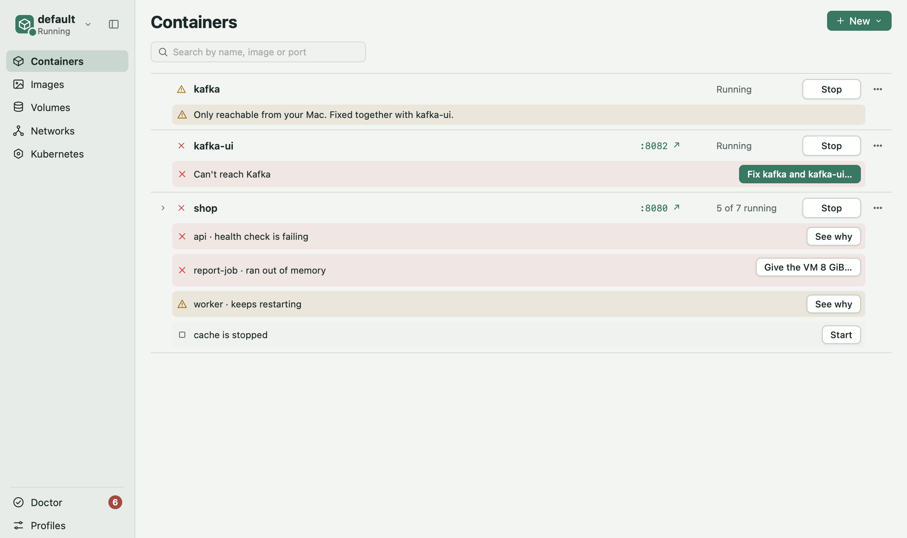
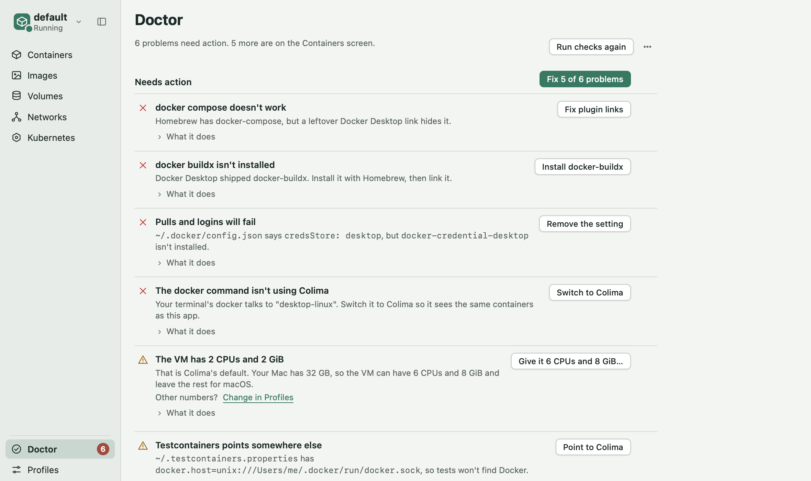
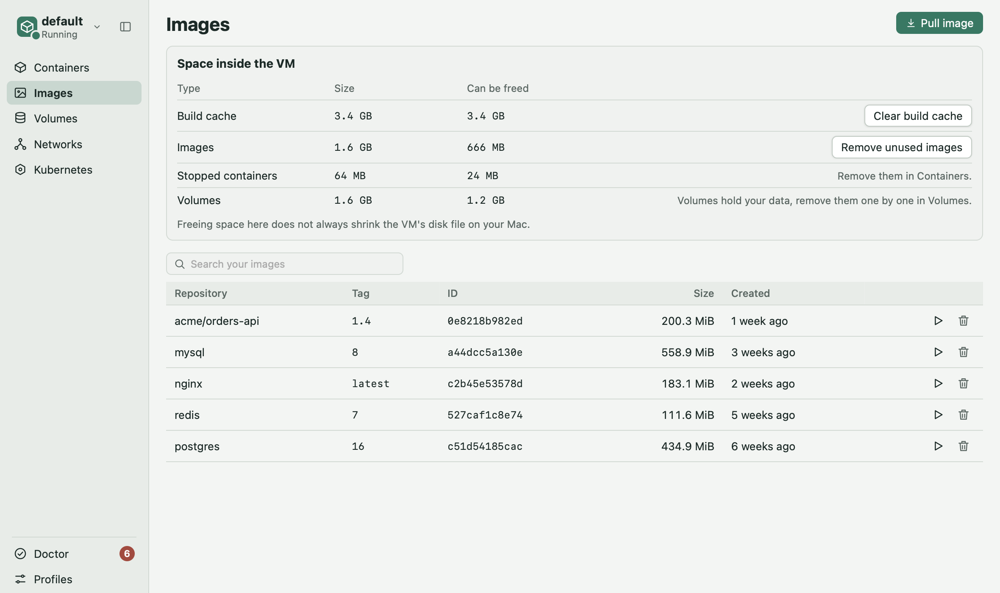
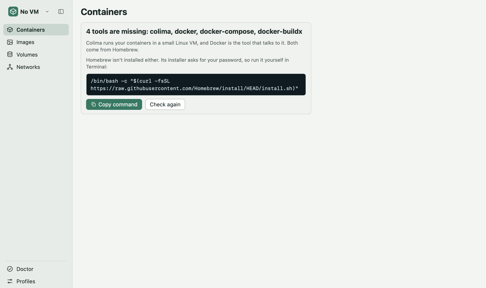

# Container UI

**Docker on your Mac, without Docker Desktop.** Free, fast, and it tells you what's wrong before you go digging.

Container UI is a native Mac app for container runtimes: [Colima](https://github.com/abiosoft/colima), OrbStack, Rancher Desktop, Podman Desktop, and Docker Desktop. You get a unified interface for containers, images, volumes, networks, and Compose projects. No license, no sign-in, no heavy background app.

## Install in one line

    curl -fsSL https://raw.githubusercontent.com/OWNER/REPO/main/scripts/install.sh | sh

That's it. The line downloads the app, puts it in Applications and opens it. Is Colima missing? The app installs it for you. Run the same line again to update.

Apple Silicon Macs. Prefer to click? See [Install by hand](#install-by-hand).

## Why you'll like it

**It finds the problem and fixes it.** A container that can't reach Kafka, a database out of memory, a folder your container can't see: each one shows up in plain words on its row, with one button that fixes it. Every fix asks first and can be undone.

**Doctor checks your whole setup.** Leftovers from Docker Desktop that break `docker compose`, logins that will fail, Testcontainers pointing at the wrong place, a VM that's too small. Doctor lists them and fixes them for you.

**Leaving Docker Desktop is painless.** It brings your volumes over, so your projects start with their data. It also finds the Compose projects already on your Mac, and fixes the settings Docker Desktop leaves behind.

**Everything Docker Desktop did, minus the weight.**
1. Containers, images, volumes and networks, searchable
2. Compose projects, started from any folder in your home
3. Logs, a shell, stats and health for every container
4. Pull from Docker Hub, GHCR, ECR or Google Artifact Registry
5. Kubernetes (Colima's K3s), read-only, with pod problems in plain words
6. Several VMs ("profiles"), each sized to your Mac

**Safe by design.** The app only runs the commands it shows you, from a fixed allowlist. Nothing changes until you click.

## First launch

On a fresh Mac, the app sees what's missing and offers to install it with one click: Colima, the Docker CLI, Compose and Buildx. If Homebrew itself is missing, one button opens Terminal with its installer, where you type your password.

## Try it, tell us, help build it

This is early, and your feedback shapes it.

1. **Something confusing or broken?** [Open an issue](../../issues/new/choose) with a screenshot. Two lines is plenty.
2. **Want to fix it yourself?** Pull requests are welcome. [AGENTS.md](AGENTS.md) has the UX rules and the checks to run; a maintainer reviews every PR.

## Install by hand

1. Download the `.dmg` from the [latest release](../../releases/latest), open it, and drag Container UI to Applications.
2. The app isn't signed by Apple, so the first time you open it macOS says it can't check it. Open System Settings, then Privacy & Security, and click **Open Anyway**. You only do this once.

**For contributors:** `docs/SUMMARY.md` (what was built and learned), `docs/SPEC.md` (what is left), `docs/VERIFY-ON-YOUR-MAC.md` (15-minute real-machine check), `docs/EVALUATION.md` (comparison with other tools), `CHANGELOG.md`.

## Release
Push a version tag and GitHub Actions runs the tests, builds the `.dmg` on an Apple Silicon runner and attaches it to a Release (`.github/workflows/release.yml`):

    git tag v0.2.0 && git push origin v0.2.0

Bump `version` in `package.json`, `src-tauri/tauri.conf.json` and `src-tauri/Cargo.toml` first, so the file name matches the tag.

## Build from source
Prereqs: Node 22.6+, Rust (rustup), Colima and the Docker CLI (`brew install colima docker`).

    npm install
    npm run tauri dev       # development
    npm run tauri build     # release .app and .dmg

The app talks to the docker context Colima creates for the selected profile (`colima`, or `colima-<profile>`).

## What it does
- **Containers** (home): the VM in one line (state, CPU, memory, disk, Restart, Stop), then every container with status, problems, port links, CPU and memory. Compose projects are grouped; Kubernetes pod containers sit in their own folded group and can't be stopped or removed here. Rows are one line; their checkbox and Logs, Shell, Restart, Stop and Remove show on hover or focus. Pick several rows to start, stop or remove them together (only rows you can see: folded groups are left out). The New menu runs or pulls an image, or lists the Compose projects on your Mac (found with Spotlight when the app opens). Each project is one row with Start or Stop and a ⋯ menu: Rebuild and start, Update images and start, logs, Show in Finder, Remove containers (volumes stay), and the commands to run it yourself. The profile switcher at the top of the sidebar changes profile and starts or stops any of them; Doctor and Profiles sit at the bottom. The sidebar folds to icons and remembers it. A container page has logs, inspect, stats, mounts, health, activity, network checks and Open a shell.
- **Images**: search your images, pull (Docker Hub search, a name, or a private registry such as GHCR, ECR or Google Artifact Registry), guided Run that reads what the image declares, and what takes space inside the VM, with one cleanup per kind (never your volumes).
- **Volumes**: sizes and which containers use them; in-use volumes can't be removed.
- **Networks**: create, connect, and Test a connection ("why can't A reach B?").
- **Kubernetes** (shown when the profile has it): Colima's K3s cluster, read-only, with plain-words pod problems and Open in k9s.
- **Profiles**: create, edit CPU, memory and disk, start, stop, delete.
- **Doctor**: every check in one place, with a sidebar badge for what needs action. See below.

When a start or stop fails, the app says why and offers the next step.

## Doctor
Doctor checks your setup and what runs on it, and says what it found in plain words, with the evidence ("DATABASE_URL is postgres://localhost:5432"). Findings are grouped: **Needs action**, **Worth knowing**, and the checks that passed (folded). Each one also shows on its container's row and page. Nothing changes until you click a fix, and every fix asks first.
- **Setup**: what Docker Desktop used to handle (plugins, credentials, context, start at login, VM size).
- **Containers**: crashed, ran out of memory, keeps restarting, failing health check; postgres or mysql stopped for a missing password setting.
- **Network**: a container that looks for another one at `localhost`; containers that use each other's names but share no network (or sit on Docker's default network, which has no name lookup); a container that couldn't start because its port is taken, and who holds it; Kafka UI and apache/kafka set up so other containers can't reach the broker.
- **Images**: an image built for another CPU than the VM's.
- **Storage and VM**: a database whose data isn't in a named volume; space held by unused images and build cache; a VM too small for what runs on it.

Fixes come in four kinds:
- **Fix**: replaces a container with a copy that has the right settings (same image, ports, volumes, networks, restart policy and environment), and puts the old one back if the copy doesn't stay up. It keeps the old one as `<name>-old` until the new one runs. Only offered when the app can carry every setting over; otherwise you get the commands.
- **Connect**: adds containers to a shared network. It only adds, so nothing is restarted or removed.
- **Commands to copy**, when only you can decide (a password) or the container comes from Compose or Kubernetes, where its file is the source.
- **Open a page** (Profiles, Images) for changes made there.

"Not an issue" hides a finding here and on its container; the page lists what you hid so you can bring it back. **Test a connection** checks whether one container can reach another, step by step. Every command names the profile's context, so it works whatever your terminal points at.

## Tests and checks
    npm test                                   # TypeScript logic (node --test), then the screens in jsdom (vitest)
    npm run test:ui                            # only the screens
    cd src-tauri && cargo test                 # Rust: allowlists, deadlines, process groups
    npm run check                              # builds the browser preview, runs every browser check (needs Playwright)

The first time, run `npx playwright install chromium webkit`. Checks run in both engines; the app ships in WebKit.

## Browser preview (no Tauri or Rust needed)
    npm run preview                            # writes preview/index.html

The same UI runs against a simulated backend (`preview/mock.ts`). Pick a scenario with `?scenario=`: running, stopped, failed, stuck, stopfail, missing, partial, nobrew, none, two, nonet, desktop, mismatch, k8spods, nocompose. Add `&k8s=on` for Kubernetes.

## Safety
The page can only ask the backend for allowlisted commands: per-command flag lists for `docker`, `docker rename` with exactly two container names, a shape check for `docker run` (detached only, a fixed set of flags including `--restart`, named volumes or folders under your home outside `~/Library` and hidden folders, no host network), read-only `kubectl`, a fixed Spotlight query for Compose files (paths only, no file is read), and Colima contexts and profile names only. Publishing ports on 127.0.0.1 and mounting your folders read-only are the Run panel's defaults, not rules the backend enforces. Every command has a deadline. A strict Content Security Policy is set for release builds.
